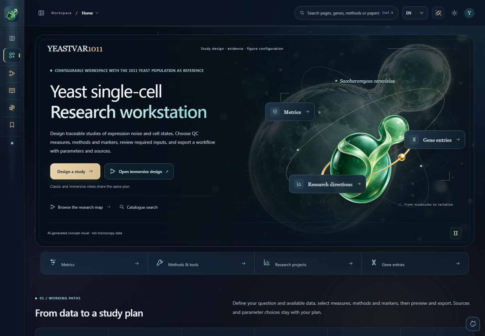

<div align="center">


# YeastVar1011

### Design a yeast single-cell study, from raw reads to biological questions.

[Open the workstation](https://yuedong0211.github.io/YeastVar1011/) · [Alternative website](https://yeastvar1011-research-atlas.robust-bread-5701.chatgpt.site) · [Contribute](CONTRIBUTING.md) · [Report an issue](https://github.com/YueDong0211/YeastVar1011/issues/new/choose)

[](https://github.com/YueDong0211/YeastVar1011/actions/workflows/pages.yml)
[](https://github.com/YueDong0211/YeastVar1011/actions/workflows/analysis-integration.yml)
[](https://github.com/YueDong0211/YeastVar1011/actions/workflows/bioconda-package.yml)
[](https://doi.org/10.5281/zenodo.23429611)

</div>

YeastVar1011 is an open-source research-plan workstation for yeast single-cell analysis. It connects QC metrics, analysis tools, multi-tag marker evidence, expression-noise estimands and research extensions to their required inputs and sources. The 1011 *Saccharomyces cerevisiae* collection provides its population-research context.

**Choose methods and markers → check inputs → review and export a documented research plan.** The workstation builds plans; tools such as STAR, Scanpy and Seurat run in your analysis environment.

中文：这是一个用于构建酵母单细胞研究方案的工作站。选择 QC 指标、工具、marker 和研究方向，核查所需数据，再导出含参数、公式与参考文献的方案。支持中文、英语、法语、西班牙语和巴斯克语；导出语言可以单独设置。



## Explore

| Area | What you can prepare |
| --- | --- |
| Raw reads and QC | Barcode/UMI recognition, alignment and BAM retention, cell calling, contamination, doublets, sample and cell QC, and compatible matrix layers |
| Marker evidence | Search genes and sources, combine tags, inspect cycle and functional evidence, compare reference panels and build a selected marker panel |
| Expression noise | Define biological units and estimands, distinguish mean effects and state composition, specify measurement models, replication and robustness checks |
| Research extensions | Enrichment, regulatory and co-expression networks, RNA dynamics, trajectories, perturbation modelling and population-genetic analyses with explicit input requirements |
| QTL catalogue | Compare expression, within-strain noise, distribution, co-expression, state, RNA-processing and additional-omics QTL traits; inspect their statistical units, input alternatives, methods and source papers |
| Plan review | Inspect dependencies, parameters, formulas, outputs and primary references; export documents, tables, a workflow and an editable plan backup |
| Interface | Classic planning or an optional immersive yeast scene; a live yeast customization studio, draggable companion, accessible controls, reduced motion and local data management |
| Local research assistant | A small on-device language model explains retrieved catalogue entries and the current plan, with clickable source records and no API key |

Both planning modes edit the same plan. The 3D cell is an authored biological illustration. Scene responses are interface cues, not experimental observations. Source-specific reference statistics remain distinct from measurements imported from your own project.

Open the draggable companion to search evidence, review missing plan inputs or get help with the current workspace. These functions work before loading the model. Choose **Load small model** for local Qwen explanations of matched records; unmatched questions return a search prompt instead of unsupported generated text. The first load downloads about 519 MB of fixed model files. Model controls also support importing the five pinned files and loading only from the browser cache. Questions and selected plan context stay on the device. Stop, unload, conversation clearing and model-cache deletion have separate controls. See [local model setup and verification](docs/LOCAL_ASSISTANT.md).

The v22 catalogue adds Ty/repeat-expression analysis, between-strain variance across cell states, cross-state programmes, modular RNA dynamics, evidence-stratified regulatory networks and mechanistic simulation. New marker evidence includes the complete author-selected Su 2023 amino-acid/glucose-starvation tables and named Brettner 2024 state associations. The [v22 evidence update](docs/RESEARCH_UPDATE_v22.md) describes inputs, sources and remaining coverage needs.

The [v24 research update](docs/RESEARCH_UPDATE_V24.md) adds joint spliced–unspliced mechanistic models, RNA measurement-length sensitivity, implementation robustness and study-wide multiple-testing design. Marker evidence can also be filtered by original study condition, reported direction, dataset accession and explicit use as a single-cell marker. The marker workspace includes a [data-resource directory](docs/DATABASE_RESOURCES.md) that distinguishes imported SGD/GO records from external regulation, interaction, expression and population resources.

## Current release

Version **22.1.0** (24 October 2026) unifies the website, Windows portable download and source package. It includes the later marker, QTL and noise/genetics/evolution catalogues, with analysis choices linked to their required tools and inputs. See [release and sharing instructions](docs/RELEASES.md).

## Run locally

**Windows, no development tools:** download the portable ZIP from [the latest release](https://github.com/YueDong0211/YeastVar1011/releases/latest), extract the whole folder and open `START.cmd`. `STOP.cmd` stops the local server; `CREATE-SHORTCUT.cmd` creates a shortcut.

**Windows, macOS or Linux, with Node.js 22+:**

```sh
git clone https://github.com/YueDong0211/YeastVar1011.git
cd YeastVar1011
npm start
```

Node.js 24 LTS is recommended; Node.js 22 is supported. On Linux and macOS, `sh scripts/setup.sh --start` checks the environment and starts the workstation. On Windows, `scripts/setup.ps1 -Start` provides the same sequence.

Open the address printed in the terminal. Starting the app needs no dependency installation or build. The server listens on your own computer. Set the `PORT` environment variable to choose another port.

For development and validation:

```sh
npm ci
npm run check
npm run test:server
npx playwright install chromium
npm run test:public
```

`CHROME_PATH` optionally selects an installed Chromium/Chrome executable for the browser check. To package a Windows portable release, run `research/package-portable.ps1` in PowerShell.

## Local data and privacy

Plans, selections and preferences are stored in your browser. The application does not upload raw sequencing data or run a remote sequencing pipeline. Imported observations remain in the page unless you export them. The catalogue guide searches bundled records; it is not a hosted language-model service. Opening an external reference or GitHub link leaves the workstation. The optional companion uses remotely referenced media unless you select a local image.

Settings provides scoped cleanup and a full local reset. Export a plan backup before clearing it. Local and hosted copies, different browsers and different website addresses have separate browser storage; use an exported backup to transfer a plan.

## Linux and cluster QC workflow

The separate [analysis workflow](analysis/README.md) uses pinned Snakemake, STARsolo, samtools, FastQC and MultiQC environments. Configure the barcode/UMI layout, read roles, reference annotation, sample sheet and resource limits before running it. It retains tagged BAM files, Gene/GeneFull/SJ/Velocyto outputs, chromosome summaries and per-barcode QC. The SLURM profile specifies the cluster account, partition and resources. The **Install & cluster** page connects installation, configuration, downloads and plan import/export.

See [deployment and environment setup](docs/DEPLOYMENT.md), [analysis documentation](analysis/README.md) and [open-science publication](docs/PUBLISHING.md).

## Evidence, citations and licensing

- [Data sources and evidence conventions](DATA_SOURCES.md)
- [Third-party licenses and attribution](THIRD_PARTY_NOTICES.md)
- [Detailed workstation guide](docs/WORKSTATION.md)
- [Contribution guidelines](CONTRIBUTING.md)

Original project code and documentation are available under [MIT](LICENSE). Bundled libraries, fonts, citation styles, source datasets and externally referenced media retain their own licenses. Cite the original selected methods and datasets in addition to this software; `CITATION.cff` provides software citation metadata. The project is an independent workstation and does not imply endorsement by the original data providers or software authors.

## Hosting

Serve the contents of `dist/` from any HTTPS static host. Relative asset paths support a repository subdirectory. The included GitHub Actions workflow validates the catalogue and local server, runs a browser check, then deploys `dist/` to GitHub Pages on updates to `main`. Enable GitHub Pages with **GitHub Actions** as its source when using a fork. See [GitHub’s workflow documentation](https://docs.github.com/en/pages/getting-started-with-github-pages/using-custom-workflows-with-github-pages).

## Contact

[Yue Dong — research collaboration](mailto:yuedong02@outlook.com). Use [GitHub issues](https://github.com/YueDong0211/YeastVar1011/issues/new/choose) for interface problems, method additions and evidence corrections.
